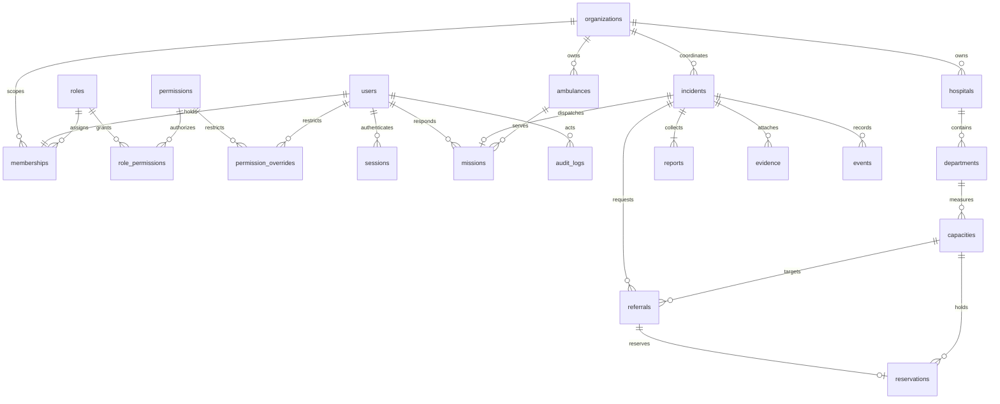

# Database design

PostgreSQL is required; SQLite is not used as a runtime fallback. Alembic revisions are in `backend/alembic/versions`. Revision 0001 uses the frozen `app/schema_v1.py` definition so later model edits cannot change the meaning of the initial migration. Revisions 0002 and 0003 introduce permission restrictions and refresh-token families. Revision 0004 migrates identity scope into normalized roles, memberships, permissions and role-permission grants while preserving existing users.



| Entity | Key integrity rules |
|---|---|
| Users | Unique normalized email and optional Google subject; credentials and account state |
| Roles / permissions | Six role rows; canonical API-action permissions; composite role-permission grants |
| Memberships | One active row per user; role and organization FKs; noncitizen roles require an organization |
| Sessions | Unique refresh HMAC; CSRF binding; indexed user and rotation-family IDs; expiration/revocation |
| Challenges | Purpose-bound HMAC, expiration, attempts, consumption; email index |
| Invitations | Unique token HMAC, fixed email/role/organization, expiry and one-time use |
| Incidents | Unique tracking HMAC; validated coordinates; allowed state and priority; duplicate self-FK |
| Reports / evidence | Incident FK; private object key unique; immutable incident history via events |
| Hospitals / departments | Organization/hospital FKs; department names unique per hospital |
| Capacity | Unique department/bed-kind pair; all counts nonnegative; occupied + reserved ≤ total |
| Ambulances | Unique registration; organization ownership; explicit service status |
| Missions | One per incident; partial unique indexes for noncompleted ambulance/responder assignments |
| Referrals | Capacity/incident FKs; at most one nonrejected referral per incident |
| Reservations | One reservation per accepted referral; reserved-to-occupied progression |
| Events | Monotonic replay cursor, actor/organization/incident references and timestamped payload |
| Audit logs | Actor, scope, action, target, details and timestamp; database triggers reject updates/deletes |
| Permission overrides | Unique user/action pair; restrictions cannot widen fixed role boundaries |

A responder is a user whose membership references the responder role. Role and organization assignments are stored only in memberships; the ORM exposes them through the User interface without duplicating database columns. Roles and permission grants are reference data seeded by migration, never sample operational data. Notifications are projections of the persistent event stream rather than a duplicate copy of operational truth.

Capacity changes retain before/after values in append-only events. Mission transitions and incident changes share the event history. UUID primary keys identify operational entities; PostgreSQL sequence event IDs support ordered replay. Date/time fields use timezone-aware timestamps.

Audit/event triggers prevent ordinary updates and deletes, but do not defend against a database superuser or a privileged migration owner disabling them. Production should separate migration and runtime database credentials and restrict DDL and TRUNCATE privileges.

## Migration and backups

```sh
docker compose exec backend alembic current
docker compose exec backend alembic upgrade head
./infrastructure/backup.sh ./backups
```

`restore.sh` restores into an empty database and intentionally does not drop existing objects. Back up object-store data separately; the SQL dump contains evidence metadata only. Schedule backups outside the application, encrypt them, restrict access and perform restore drills before deployment.
