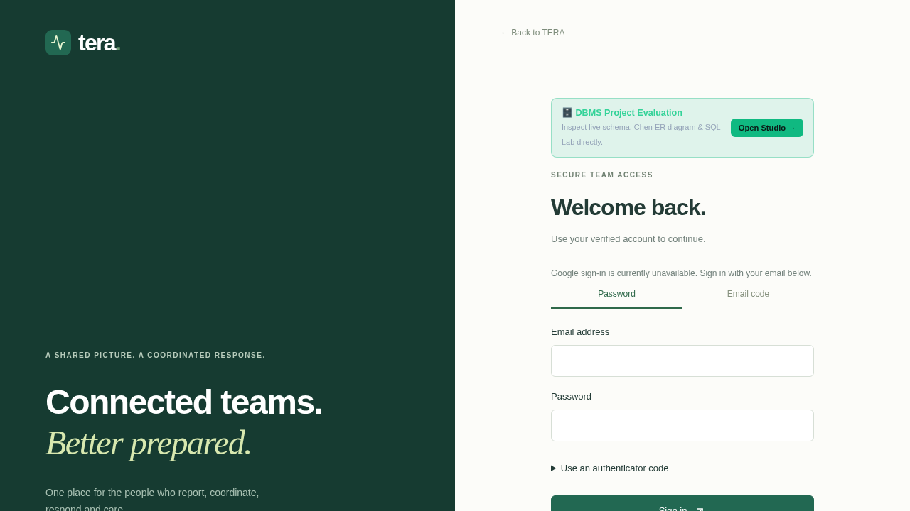

# Google sign-in follow-up and testing record

Date: 10 November 2026 (Asia/Kolkata). Target confirmed by the user: http://localhost:5173.

## Evidence and current status

Previous conversation transcripts were not available in this session. Historical work below is taken from `LOCAL_AUDIT.md`, `verification.md`, the existing test sources, and the current working tree; historical results are not represented as new runs.

The running `tera-audit-live` backend was checked without printing secrets. Both `GOOGLE_CLIENT_ID` and `GOOGLE_CLIENT_SECRET` are absent; `PUBLIC_URL` is correctly set to `http://localhost:5173`. This explains the reported “Google Sign-In is not configured for this deployment” message. Google authentication cannot be enabled by a UI change alone.

**Updated status:** user-supplied OAuth credentials have now been configured in the ignored `backend/.env` file and the local backend restarted. The provider endpoint reports `google=true`. A real authorization-start request returned HTTP 302 to `accounts.google.com` with callback `http://localhost:5173/api/v1/auth/google/callback`, scopes `openid email profile`, and an OAuth state value. Health checks confirm PostgreSQL and Redis are available. These checks do not establish successful Google consent or token exchange; the user must complete sign-in in their browser. Credential values and state are intentionally omitted from this record.

The missing-credential diagnosis and test table below describe the earlier checks before credentials were supplied.

## Changes in this follow-up

- Centralized Google readiness in `Settings.google_configured`: both client ID and secret must contain non-whitespace text.
- Used that check in the public providers endpoint, administrator system status, and Google authorization endpoint. Partial configuration returns unavailable instead of starting a broken OAuth flow.
- Normalized the trailing slash on `PUBLIC_URL` when constructing the callback URL.
- Show the Google link and email divider only when the backend reports Google configured. Otherwise show “Google sign-in is currently unavailable. Sign in with your email below.” Password and email-code sign-in remain available.
- Added regressions for missing/partial/blank credentials, complete configuration, the exact localhost callback, and both frontend provider states.
- Updated README setup instructions and restarted the local backend to load these changes.

## Checks executed in this follow-up

| Check | Result |
| --- | --- |
| Full isolated backend suite (`tera-audit-tests`, PostgreSQL test database) | 84 passed, 86 warnings, 39.38 seconds |
| TypeScript and Vite production build | Passed; existing large-chunk advisory remains |
| Frontend component tests | 8 passed |
| Public desktop/mobile reporting and reload persistence | 2 passed |
| Six role portal browser checks | Operator, responder, hospital, analyst and citizen passed initially; admin passed on focused rerun |
| Backend health after restart | `status=ok`, database connected, Redis active |
| Live providers endpoint | `google=false`, `email=true`, matching absent Google credentials |
| External Google consent/token exchange | Not run: OAuth credentials absent |

The first combined browser run had 7 passes and 1 failure: admin login received “Service unavailable” immediately after restarting the backend. After confirming backend readiness, the unchanged admin test passed in 5.7 seconds (5.4 seconds test execution). No claim is made that the initial run was entirely green. Existing backend warnings include library deprecations and the patient/referral foreign-key cycle.

Commands used:

```sh
podman start tera-audit-tests
# Backend results: backend/test-results.txt
podman exec tera-audit-web sh -c 'npm run build && npm test'
podman restart tera-audit-live
podman exec tera-audit-web sh -c 'TERA_E2E_URL=http://localhost:5173 npm run e2e -- e2e/public.spec.ts e2e/portals.spec.ts'
podman exec tera-audit-web sh -c 'TERA_E2E_URL=http://localhost:5173 npm run e2e -- e2e/portals.spec.ts --grep "admin portal"'
```

## Earlier work and testing preserved from the audit

The 10 November audit records these completed changes:

- Removed fabricated frontend incident/audio/timeline data and shared-password privileged provisioning; required real backend/database responses and an explicit application secret.
- Restricted DBMS Studio, raw SQL and data samples by role; used read-only SQL transactions, timeouts and bounded results.
- Fixed refresh credentials, permission aliases, scoped tracking/PDF/evidence access and hospital queue/acceptance behavior.
- Persisted evidence associations, prevented evidence reuse, enforced transactional rollback, validated casualties/ages and serialized idempotent report submissions.
- Added patient/referral/hospital relationships, companion scope and database migrations 0009–0012.
- Persisted recordings, corrected browser workflow expectations and enabled container file watching.

The same audit records: production build and 7 component tests passed; 9 browser tests including the complete report-to-closure lifecycle passed in 30.7 seconds; 77 backend tests passed in 186.57 seconds, followed by 31 focused regressions in 106.36 seconds. It also records actual WAV storage, Mailpit OTP delivery/verification, resource CRUD and duplicate rejection, concurrent allocation protection, an API restart preserving incident/evidence/PDF access, and observed WebSocket delivery to an already-open operator dashboard. A final portal/realtime run with `TESTING=false` passed 7 tests in 22.8 seconds.

The older 6 November `verification.md` records 26 backend tests with 87% statement coverage, 4 component tests, 9 browser tests, PostgreSQL migrations 0001–0004, append-only audit protections, SMTP delivery, S3 protocol-emulator checks and Google adapter tests. That coverage figure applies only to that historical run. Later local audit infrastructure supersedes its historical Podman availability limitation.

Historical adapter tests do not establish live Google, paid speech or telephony operation. The audit used filesystem evidence storage because the historical MinIO image could not be pulled. Live Google, external inbox delivery and production operations remain separate integration acceptance work.

## Complete Google setup for this local app

1. In the intended Google Cloud project, configure Google Auth Platform branding/audience and create an OAuth client of type **Web application**. If the app is in testing mode, add the account that will test consent as a test user.
2. Register this exact authorized redirect URI: `http://localhost:5173/api/v1/auth/google/callback`. Keep using `localhost`, rather than switching to `127.0.0.1` during the flow.
3. Set backend-only `GOOGLE_CLIENT_ID` and `GOOGLE_CLIENT_SECRET`, retaining `PUBLIC_URL=http://localhost:5173`. Do not put the client secret in chat, source control or frontend `VITE_*` variables.
4. For a backend launched from `backend/`, settings load `backend/.env`. The audited container mounts that directory at `/app`. Container environment variables take precedence over `.env`; if empty Google variables were supplied when the container was created, replace them in the launch configuration and recreate the backend container. A restart does not change container environment variables. For Compose, configure the root environment and run `docker compose up -d --force-recreate backend`.
5. Restart/recreate the backend as applicable. Open `http://localhost:5173/api/v1/auth/providers` and confirm `"google": true`. This proves credential presence, not credential validity.
6. Open `/login`, choose Google and complete real consent. Confirm return to `/app`, an authenticated `/api/v1/auth/me`, and a citizen role for a newly created Google account. Also verify cancelled consent and invalid callback/state rejection. Existing email accounts deliberately require their existing sign-in method rather than automatic Google linking.

Provider reference: [Google OpenID Connect setup and protocol documentation](https://developers.google.com/identity/openid-connect/openid-connect).


