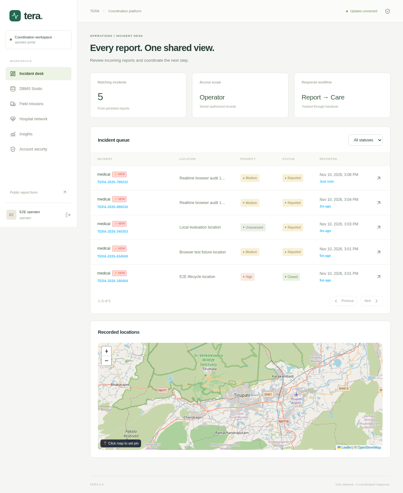

# TERA local database audit — 10 November 2026

This audit preserves the React/FastAPI/SQLAlchemy/PostgreSQL architecture and existing screens. The attached 20-mark rubric is the acceptance checklist; marks remain the evaluator's decision.

Follow-up: [Google sign-in correction and consolidated testing record](GOOGLE_SIGN_IN_FOLLOWUP.md) documents the localhost configuration diagnosis, subsequent changes, new test results, and the credentials still required for live Google authorization. Results below remain the original audit record.

## Implemented corrections

- Reports, incident lists, tracking, voice reports and incident detail now require successful backend responses. Removed fabricated local incidents, timelines, audio metadata and client-to-database restoration.
- Removed shared-password privileged account provisioning and startup password resets. Required persistent database configuration and explicit application secret. Removed embedded speech-provider credentials and direct browser calls with that credential.
- Enforced authentication for DBMS Studio, administrator-only raw SQL/table samples/activity, read-only SQL transactions, timeouts, bounded results and rejection of multiple statements. Added explicit schema-laboratory permissions for operators and analysts.
- Fixed credentialed session refresh and normalized permission checks across API aliases.
- Private tracking codes are required for public incident/PDF retrieval; staff PDF access enforces incident scope.
- Hospital acceptance supplies its required reason and displays mutation errors. Hospital incident queues avoid PostgreSQL DISTINCT over JSON by filtering through a related-ID subquery.
- Pending evidence uploads create actual database rows; associations are locked and reject reuse. Failed multi-record submissions roll back. Casualty values and patient ages are validated; negative casualties are also rejected by a database constraint.
- Duplicate report requests return the same working tracking capability and serialize concurrent requests by idempotency key.
- Added omitted patient/referral/hospital foreign keys and reject cross-incident patient referral assignments.
- Added persistent recording volumes to Compose and portable process-restart testing using the active Python interpreter.
- Updated browser tests to follow the existing confirmation screen, role redirects and hospital workflow. Container development enables file polling so host edits invalidate Vite's cache.

## Running evaluation environment

Frontend: http://localhost:5173. API documentation: http://localhost:8000/api/docs. Local email: http://localhost:8025.

The running API has `TESTING=false`; the guarded fixture was loaded separately before normal startup. The live database is `tera_e2e_test`; backend tests use a separate `tera_test` database. Both are actual PostgreSQL 16 databases. The existing E2E fixture seeds six role accounts (`admin`, `operator`, `responder`, `hospital`, `analyst`, `citizen` at `example.com`) with password `test-passphrase-123`. These are test credentials only.

Containers are named `tera-audit-postgres`, `tera-audit-redis`, `tera-audit-live`, `tera-audit-web`, `tera-audit-tests`, and `mailpit`. Restart the existing local environment with:

```sh
podman machine start  # only when stopped
podman start tera-audit-postgres tera-audit-redis mailpit
podman start tera-audit-live tera-audit-web
```

The VM was increased to 6 GB to support simultaneous Chromium role contexts. Do not run the destructive test fixture against operational data; its code requires TESTING=true and an `_e2e_test` database suffix.

## Verification commands

```sh
# Existing backend test container includes the declared test dependencies.
podman start tera-audit-tests
# Results: backend/test-results.txt (ignored generated output)

podman exec tera-audit-web sh -c 'npm run build && npm test'
podman exec tera-audit-web sh -c 'TERA_E2E_URL=http://localhost:5173 npm run e2e'
```

Use the README's Docker/uv steps to reproduce on another machine. Migrations 0009–0012 add evidence persistence, DBMS role grants patient relationship constraints and scoped companion access.

## Rubric demonstration cases

| Input / case | Expected evidence | Observed result |
|---|---|---|
| Report and restart | Submit in citizen UI; retrieve the same PostgreSQL record after restarting API  Passed |
| Invalid input | Empty/whitespace description, invalid coordinates, negative casualty counts rejected  Passed |
| Duplicate input | Idempotency replay creates one incident and returns the original usable tracking capability  Passed |
| Access restriction | Citizen cannot dispatch; outsider cannot view scoped evidence; operational staff cannot run arbitrary SQL  Passed |
| Transaction failure | Reusing attached evidence rejects the second submission and leaves no partial incident  Passed |
| Resource race | Concurrent dispatch/bed acceptance permits only the valid winner; no double allocation  Passed |
| Full lifecycle | Report → verify → dispatch → acknowledge → on scene → referral → accept/reserve → transport → handover → completion → close  Passed |
| Reports | Analytics groups persisted incidents by status/category, joins acknowledgement events and aggregates bed/fleet utilization  Passed |
| Realtime | Scoped persisted events update staff dashboards and replay after reconnect  Passed |

## External integrations

Google OAuth, paid speech recognition and outbound telephony need valid user-supplied provider configuration. Protocol adapters are tested with controlled provider responses; this is not evidence of a live provider authorization or telephone call. No outbound call is required for the core database workflows. Configure `SARVAM_WEBHOOK_SECRET` and send `Authorization: Bearer <secret>` for provider callbacks and private agent tools; unconfigured or unauthenticated requests are rejected. The exposed original provider credential must be revoked by its owner.

Private S3 storage is supported and its adapter is tested. The configured historical MinIO image could not be pulled from either Docker Hub or Quay during this audit; local evidence uses the existing persistent filesystem storage path. SMTP integration is exercised using actual local delivery, not fabricated codes.

## Final verification results

- Production TypeScript/Vite build: passed (existing large-chunk advisory remains).
- Component tests: 7 passed.
- Browser tests: 9 passed, including the complete lifecycle and all six portals, in 30.7 seconds.
- Backend full suite: 77 passed in 186.57 seconds. Final focused regression run: 31 passed in 106.36 seconds, including the additional voice-idempotency test.
- Real WAV upload to persistent recording storage: passed.
- Live SMTP/OTP: actual Mailpit delivery and code verification passed.
- Live resource create/read/update/retirement and duplicate rejection: passed.
- Actual running API restart: passed; the same PostgreSQL incident, evidence association, evidence file and generated PDF remained retrievable.
- Explicit WebSocket delivery: passed; a report submitted from a separate citizen browser context appeared in an already-open operator dashboard and its persisted `incident.reported` frame was observed.
- Final portal/realtime rerun with `TESTING=false`: 7 passed in 22.8 seconds.
- Normal-mode health: database connected, Redis active; unconfigured speech returns NOT_CONFIGURED.

Generated logs are ignored to avoid committing session-bearing browser traces. Test source remains in the repository. Existing warnings concern library deprecations and the patient/referral foreign-key cycle; database constraints remain enforced.



## Voice-agent follow-up

See [voice implementation and live verification](VOICE_AGENT_IMPLEMENTATION.md) for provider configuration, six-language live synthetic-speech checks, victim-count reconciliation, persistent conversations, Google role approval, new regression results, and remaining clinical/provider acceptance work.
