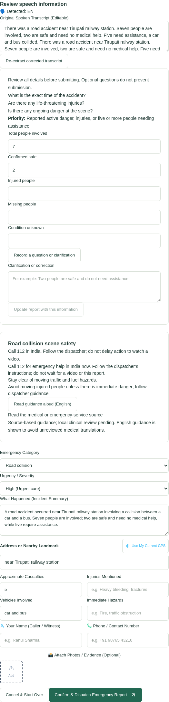
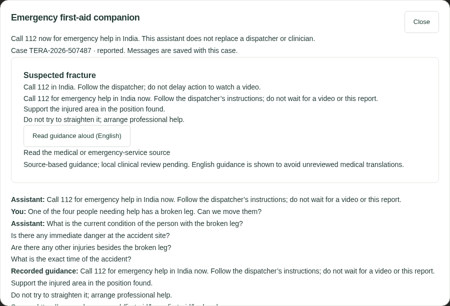

# Voice agent implementation and live verification

Date: 10 November 2026 (Asia/Kolkata). Target: http://localhost:5173. This extends the earlier [local audit](LOCAL_AUDIT.md) and [Google follow-up](GOOGLE_SIGN_IN_FOLLOWUP.md); it does not replace their historical results.

## Provider configuration and original failure

The supplied Sarvam and LLM credentials were stored only in ignored `backend/.env` (mode 0600), and the local backend was restarted. No credential values are included here. The LLM credential is for OpenRouter, so the configuration uses `OPENAI_BASE_URL=https://openrouter.ai/api/v1` and `OPENAI_MODEL=openai/gpt-4.1-mini`. Sarvam handles speech; the LLM handles factual interpretation.

Both provider authentication checks succeeded. The earlier UI falsely returned an ONLINE health object whenever the backend health request failed. That fallback was removed. Missing or failed providers now remain visibly unavailable. Real speech failure preserves an error rather than manufacturing a successful transcript.

The original extraction was multilingual keyword matching. The normal configured path now uses the actual LLM, validates its structured response, and applies server-side arithmetic and priority rules. If the LLM is unavailable, the real transcript remains editable and submission remains possible with manually entered details. Automated tests deliberately clear all external provider credentials.

## Implemented behavior

- Sarvam transcribes recordings; transcripts and extraction records are persisted in PostgreSQL and recording files remain in persistent storage.
- Separate fields hold total involved, confirmed safe, injured, assistance needed, missing, and unknown condition. Injured counts are not added to totals. Conflicting counts leave assistance unknown and prompt clarification. Final affected count uses assistance needed.
- Server priority rules recommend critical for a reported immediate life threat; high for active danger, injuries or at least five people needing help; otherwise medium pending assessment. The operator still chooses the assessed priority and can correct the confirmed assistance count.
- The review form displays editable fields, the priority explanation and clarification questions. Citizens can type or record a clarification. The backend combines it with prior context and persists the conversation. Correcting the original transcript preserves later clarification history.
- A localStorage draft identifier points to the database record; it does not store or simulate report contents. Refresh restores the transcript, extraction and conversation from the server.
- Voice submission includes an idempotency key, confirmed extraction and transcript corrections. The same case ID is retained through the existing dispatch, responder, referral, hospital handover and closure workflow. PDFs include the separate count fields.
- The companion now uses database-backed sessions and messages. Its primary UI no longer simulates a browser-only session or promises an ambulance/telephone callback. New condition updates produce persisted events for staff review; they do not silently rewrite an operator's decisions.
- Companion access requires the private case tracking code or an authenticated, scoped staff account. Concurrent requests use a nonblocking advisory lock and receive a retry response instead of freezing the async API.
- First-aid output comes from a fixed source-based catalog. The model can select a topic, but cannot write medical procedures or invent video URLs. Guidance covers general safety, CPR, choking, bleeding, thermal burns, fractures, unconsciousness, road collisions, drowning, electrical danger, fire and flooding. CPR calls for emergency services and dispatcher instructions immediately; video is optional. Adult CPR video is not shown when age is unknown or the patient is a child. Infant choking uses a separate source/video.
- New Google users reach profile confirmation and intended-role selection. Staff requests remain pending; only an administrator can approve them with a valid organization. Existing users retain their assigned role. Administrators review requests in the People page. Existing users can open profile confirmation from Account security.
- Migrations 0013 and 0014 add onboarding/role-request records and persistent companion context.
- Hospital handover updates the visible arrival list from the successful server response immediately, then refreshes the underlying queries.

## Executed verification

| Check | Result |
| --- | --- |
| Full backend suite after final backend changes | **96 passed**, 98 warnings, 41.19 seconds |
| Frontend TypeScript/Vite build | Passed; existing large-bundle advisory remains |
| Component suite | **8 passed** |
| Live provider authentication | Sarvam accepted the key; OpenRouter returned an actual completion |
| Six live TTS → STT → LLM synthetic speech fixtures | English, Telugu, Hindi, Tamil, Kannada and Malayalam all returned **7 involved / 2 safe / 5 needing assistance** and the car/bus vehicles |
| Actual browser MediaRecorder flow with synthetic microphone input | Start Recording → Done → Transcribe & Extract Info passed through the real backend and providers; 7 involved / 2 safe restored into the form |
| Contextual correction in browser | Updated 2 safe / 5 needing help to **3 safe / 4 needing help** while preserving total 7; refresh retained the correction |
| Voice submission | HTTP 201; persisted case and private tracking capability returned |
| Companion | A typed broken-leg question was saved, selected fracture guidance, and remained visible after browser refresh |
| PDF | HTTP 200 with a valid PDF signature for the submitted voice case |
| Actual API restart | Same case tracking, saved conversation and PDF remained available |
| Six role portals after API concurrency fix | All six passed |
| Complete citizen → operator → responder → hospital → closure browser lifecycle | Final focused run passed in 9.9 seconds (9.5 seconds test execution) |
| Public desktop/mobile and report reload tests | Passed in the integrated browser run |
| Realtime browser test | New report reached the already-open operator dashboard through WebSocket events |
| Privilege enforcement | Tests verify self-request cannot grant admin, only admin can approve, and existing roles remain unchanged |
| Concurrent companion requests | Regression verifies immediate retry response and continued API health while another update holds the lock |
| Secret scan | No supplied-key prefixes found in tracked source files; backend environment remains ignored |

Failures discovered during verification were fixed, not omitted: the first integrated browser run had ambiguous hospital selectors and a stalled hospital request. A blocking database lock inside an async companion route was identified and removed. Later lifecycle runs exposed an ambiguous completed-mission selector and delayed arrival-card updates. Test selectors now identify their own case, and the handover UI applies the confirmed response immediately. A manual companion assertion initially selected the inner “You:” label instead of its message paragraph; the corrected assertion verified the already-persisted text. These are separate reruns, not a claim that the initial full run was green.

Existing backend warnings include library deprecations and the patient/referral foreign-key cycle. The six speech fixtures are synthetic voices: they demonstrate working provider integration and the specified count scenario, not an accuracy benchmark for noisy real callers or dialects.

## Reproduction

```sh
podman start tera-audit-tests
# Read backend/test-results.txt after the isolated test container exits.
podman exec tera-audit-web sh -c 'npm run build && npm test'
podman exec tera-audit-web sh -c 'TERA_E2E_URL=http://localhost:5173 npm run e2e'
# Explicit opt-in: uses configured paid providers for six short synthetic speech fixtures.
podman exec tera-audit-live python -m tests.manual_voice_provider_audit
```

Provider audit source: `backend/tests/manual_voice_provider_audit.py`. Summaries/transcripts are written to ignored `backend/.local/multilingual-audit.json`. Backend regressions are in `backend/tests/test_voice_intelligence.py`. Browser lifecycle tests require the existing isolated E2E fixture environment; do not seed or truncate an operational database.

## Acceptance work still requiring external verification

- Real microphone recordings from the intended users, noisy scenes, accents, mixed-language speech and longer conversations require a broader accuracy evaluation.
- The source-based first-aid catalog is **not locally clinician-approved**. Medical instructions and spoken guidance currently remain in English; multilingual conversation/extraction works, but medical translations need review before enabling them. Do not represent this as a medically certified emergency system.
- The official British Red Cross video URLs were verified from source references, and the UI supports embedded playback with an external-link fallback. Actual audiovisual playback on the user's device/network has not been certified.
- Google credential presence and authorization redirect were checked earlier. New onboarding and approval behavior are tested with controlled authentication fixtures; a real Google consent/callback and onboarding session still requires the user's account interaction.
- No real emergency service was called or dispatched. No real outbound Sarvam telephone call was placed. Local responder/hospital flows use the seeded test organizations and resources; they do not establish live hospital integration or actual bed availability.
- Keys shared in chat should be rotated before deployment. Cloud deployment was not performed.

## Sources used

- [Sarvam speech-to-text REST](https://docs.sarvam.ai/api-reference/speech-to-text/transcribe)
- [Sarvam text-to-speech REST](https://docs.sarvam.ai/api-reference/text-to-speech/convert)
- [OpenRouter authentication and compatible endpoint](https://github.com/OpenRouterTeam/docs/blob/main/api_reference/authentication.mdx)
- [Resuscitation Council UK 2025 first-aid guidance](https://www.resus.org.uk/professional-library/2025-resuscitation-guidelines/first-aid-guidelines)
- [British Red Cross burns](https://www.redcross.org.uk/first-aid/learn-first-aid/burns), [fractures](https://www.redcross.org.uk/first-aid/learn-first-aid/broken-bone), and [infant choking](https://www.redcross.org.uk/first-aid/learn-first-aid-for-babies-and-children/choking-baby)
- [British Red Cross adult CPR demonstration](https://www.youtube.com/watch?v=gDmy0of0XAk) and [infant choking demonstration](https://www.youtube.com/watch?v=NcZ2UrbSMns)
- [Road-scene first aid](https://www.gov.uk/guidance/the-highway-code/annex-7-first-aid-on-the-road), [electrical safety](https://www.electricalsafetyfirst.org.uk/safety-advice/home-and-people/house-maintenance/first-aid/), [fire safety](https://www.ready.marines.mil/Stay-Informed/Technological-Hazards/Home-Fires/), [CDC flood safety](https://www.cdc.gov/floods/safety/)




