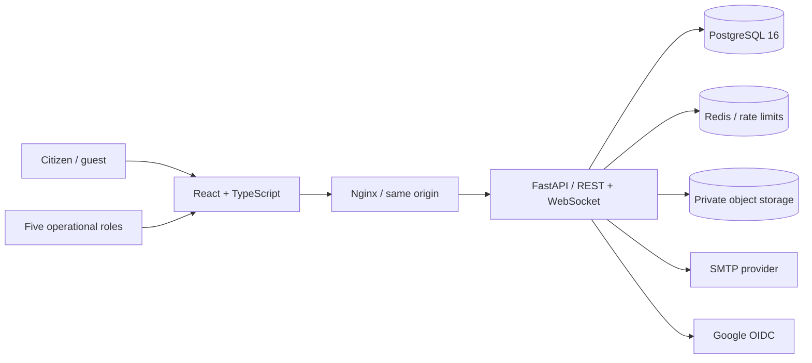
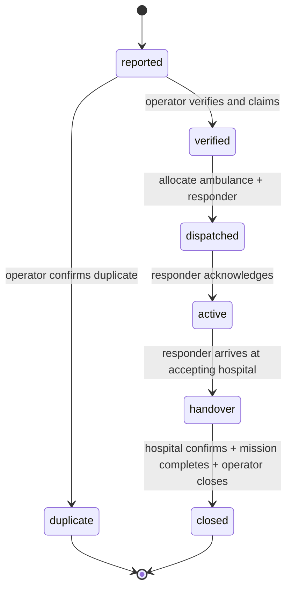

# TERA 2.0 architecture

## Runtime

The browser calls the same-origin `/api/v1` API through Nginx. React Router selects role-specific screens; TanStack Query owns server state. The server, not the UI, authorizes every protected operation. FastAPI uses SQLAlchemy 2 transactions against PostgreSQL 16. Redis holds shared rate-limit windows. Evidence is stored in a private S3-compatible bucket; SQL stores object metadata. Browser credentials use HttpOnly cookies, with a separately bound CSRF token.

## Workflow and transaction boundaries

1. A public report creates an incident, initial report and durable event atomically. A cryptographically random tracking capability is returned once; only its HMAC is stored.
2. An operator verifies a report and claims it for their organization. Priority is a human decision.
3. Dispatch locks the incident, ambulance and responder. Partial unique indexes independently enforce at most one active mission per ambulance and responder. A mission belongs to exactly one incident.
4. The responder acknowledges, goes en route and records being on scene. A hospital referral can be requested after dispatch.
5. Accepting a referral locks its capacity row and reserves one available bed in the same transaction. Rejection reserves nothing and permits another referral.
6. Transport and handover require an accepted referral. The hospital confirms the patient's arrival, moving reserved capacity into occupied capacity. The responder can then complete the mission, freeing the ambulance and responder.
7. The operator records a closure summary. Patient discharge is represented by an explicit subsequent capacity update; closing the emergency does not silently free an occupied hospital bed.

Mission sequence: `assigned → acknowledged → en_route → on_scene → transporting → handover → completed`. Skips, repeat transitions and premature closure return HTTP 409.

## Authorization model

| Role | Scope |
|---|---|
| Citizen | Registration and own account security; reporting/tracking use anonymous capabilities |
| Operator | Unclaimed intake reports and incidents/resources in their organization |
| Hospital | Own hospitals/capacity and incidents with a referral to those hospitals |
| Responder | Own assigned missions and corresponding incidents |
| Analyst | Read-only incidents, missions and analytics for their organization |
| Administrator | Cross-organization configuration, invitations, access approval, suspension, restrictions and auditing |

An account has one active role and one operational organization. These are represented by a dedicated `memberships` row referencing `roles` and `organizations`. `permissions` and `role_permissions` hold the normalized six-role action matrix. The server enforces both that matrix and its fixed role boundaries. Multiple simultaneous memberships and custom role definitions are not exposed. Per-user permission restrictions can narrow the role policy, never expand it. An administrator can explicitly approve role/organization changes; these revoke sessions. Public registration ignores client-supplied privilege fields and always creates a citizen unless a valid email-bound administrator invitation is supplied.

## Authentication

- Argon2id password hashes; minimum 12-character registration/reset passwords.
- Six-digit email codes with ten-minute expiry, five failed attempts and a sixty-second resend interval. HMAC hashes use a deployment secret as pepper. Real SMTP transport sends messages; Mailpit is the local inbox, not a verification bypass.
- Fifteen-minute signed access cookies, fourteen-day rotating refresh credentials and server-side session revocation. Refresh tokens are stored only as HMACs. Reuse of a revoked refresh credential revokes the whole rotation family.
- CSRF token bound to the current session, Origin checks and SameSite cookies. Production requires secure cookies, HTTPS and non-default secrets.
- Optional encrypted TOTP secrets; accepted TOTP time steps cannot be reused. Privileged MFA enrollment can be required through configuration.
- Authlib performs Google authorization-code/OIDC discovery, state, nonce and ID-token validation. Google sign-in creates citizen accounts only. Existing password accounts are not silently linked by email. An MFA-enabled Google account must use the email-code/password path with its authenticator.
- Audit history includes login failures, session creation/revocation, verification, resets, account changes and operational actions.

## Realtime delivery

Operational events are stored in the same PostgreSQL transaction as the action. Event IDs are allocated under a transaction-scoped advisory lock to preserve commit order for reconnect cursors. Each authenticated WebSocket replays authorized events after `after=<last_id>`, then polls the durable event log every two seconds. This survives worker restarts and does not depend on ephemeral pub/sub delivery. Identity and revocation are rechecked every cycle. The frontend reconnects with exponential backoff and invalidates the corresponding server queries. `/notifications` provides a REST synchronization path.

This implementation favors correctness and simplicity over large-scale fan-out: it polls PostgreSQL per connected socket. Redis currently provides shared rate limiting, not event transport. For high socket counts, add a transactional outbox relay and shared pub/sub while retaining durable replay. The current implementation does not claim to have been load-tested for emergency-service scale.

## Privacy and storage

Public tracking returns only lifecycle status, timestamps and a public milestone whitelist. It excludes descriptions, patient information, location, resource identities, referral details and internal notes. Tracking codes are capabilities and must be kept private; API access logging is disabled in the provided deployment to avoid recording them in URLs.

Evidence downloads are authenticated, authorized against incident scope and audited. Images are decoded, validated and re-encoded without original metadata. Audio requires an allowed MIME type and container signature. All uploads are limited to 10 MB; the reverse proxy adds an 11 MB request cap. Evidence is always an attachment, with no public bucket policy. File decoding is not a malware-scanning service; production deployments should add scanning and retention policies appropriate to their organization.

Coordinates are explicitly provided by the reporter, staff registry or a responder's on-demand geolocation reading. Unknown coordinates remain null. Hospital recommendations show recorded capacity and straight-line distance, with a human-review explanation. The application makes no medical decisions and invents no travel times or live movement.

## Deployment boundaries

The Compose definition is a local development deployment with persistent volumes and health checks. Production requires TLS termination, controlled ingress, unique secrets, SMTP credentials, Google OAuth configuration, private object-store credentials, database access policy, monitoring, backup scheduling, retention policy and an operational response team. No production account or cloud deployment is provisioned by this repository.

Nginx overwrites forwarding headers and the backend trusts the private proxy network. The backend port is not published by Compose. Do not expose the backend directly while using `--forwarded-allow-ips=*`; restrict the trusted proxy addresses in deployments with a different network boundary. Swagger UI is served with a separate CSP that permits its documentation CDN, while application pages retain a stricter policy.
